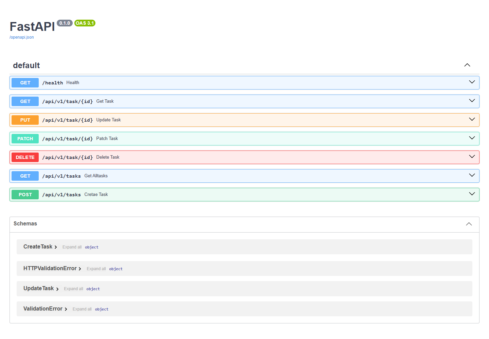

# Task Management API

API REST asynchrone de gestion de tâches, construite avec FastAPI, Beanie et MongoDB. Les tâches incluent titre, description, priorité, échéance et statut.

## Aperçu

Capture de Swagger UI générée depuis les routes du projet ; elle illustre la documentation, sans valider les opérations MongoDB.

## Fonctionnalités implémentées
| Méthode | Route | Fonction |
|---|---|---|
| GET | `/health` | Vérifier la connexion MongoDB |
| GET | `/api/v1/tasks` | Lister les tâches |
| GET | `/api/v1/task/{id}` | Consulter une tâche |
| POST | `/api/v1/tasks` | Créer une tâche |
| PUT | `/api/v1/task/{id}` | Mettre à jour une tâche |
| PATCH | `/api/v1/task/{id}` | Modifier les champs fournis |
| DELETE | `/api/v1/task/{id}` | Supprimer une tâche |

## Installation
Prérequis : Python 3.11+ et MongoDB accessible, local ou Atlas.
```bash
git clone https://github.com/KSSIRI05/API-PROJECT.git
cd API-PROJECT
python -m venv .venv
# Windows : .venv\Scripts\activate
# Linux/macOS : source .venv/bin/activate
pip install -r requirements.txt
```
Créer `.env` à la racine :
```env
MONGO_URI=mongodb://localhost:27017
```
L'application utilise la base `API-DATA` et initialise Beanie au démarrage.
```bash
uvicorn src.main:app --reload
```
Swagger : http://localhost:8000/docs ; ReDoc : http://localhost:8000/redoc.

## Docker
```bash
docker build -t api-tasks .
docker run --env-file .env -p 8080:8080 api-tasks
```
Dans un conteneur, `localhost` désigne le conteneur. Pour MongoDB sur l'hôte avec Docker Desktop, utiliser `mongodb://host.docker.internal:27017` dans un fichier d'environnement dédié ; pour Atlas, utiliser son URI. Swagger est alors accessible sur http://localhost:8080/docs. Aucun fichier Docker Compose n'est fourni.

## Tests et CI
```bash
pytest test_api.py -v
```
Les tests accèdent à MongoDB et créent des données : utiliser une instance de test séparée. GitHub Actions lance Pytest et construit une image Docker sans la publier (`push: false`). Le secret `MONGODB_ATLAS_URI` doit être configuré. Aucun déploiement automatique n'est prévu.

## Organisation et limites
`src/routes/` : endpoints ; `src/models/` : documents Beanie ; `src/schema/` : validation ; `src/config/` : connexion MongoDB.
Le projet ne contient pas d'authentification ni de gestion multi-utilisateur. Une liste vide retourne actuellement HTTP 404.
